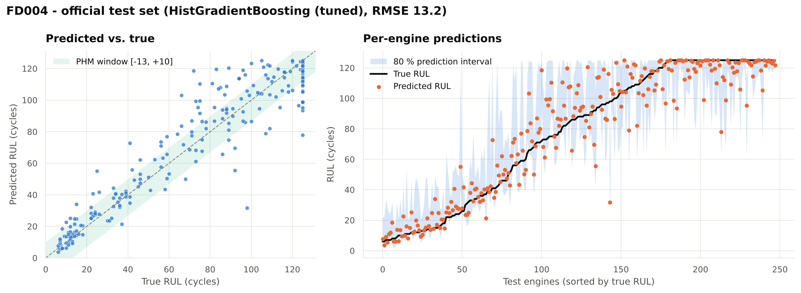
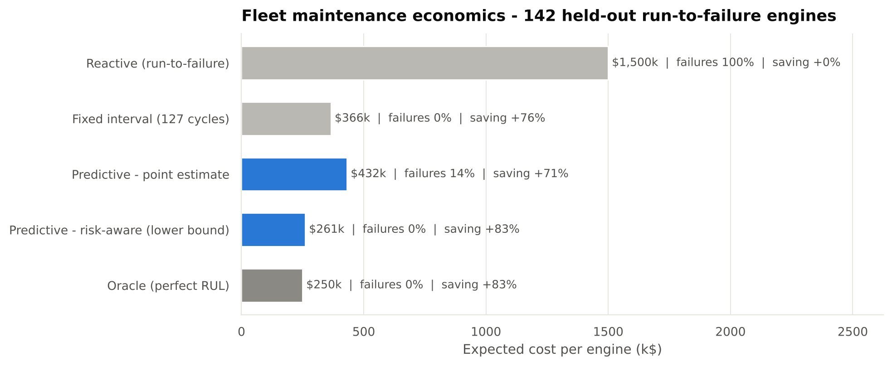
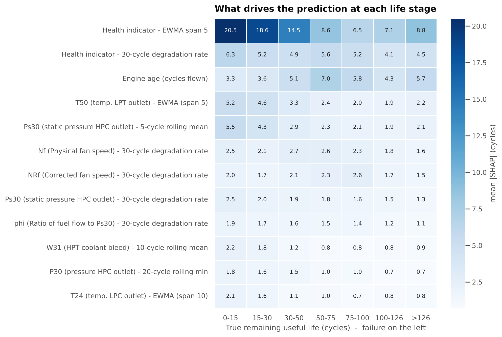

# ✈️ AeroRUL — Prédiction de la durée de vie résiduelle des moteurs d'avion

**Un système complet de maintenance prédictive sur les données NASA C-MAPSS (FD001–FD004) : feature engineering causal, ensembles d'arbres combinés (stacking), intervalles de prédiction conformes, explications SHAP exactes, simulateur de coûts de maintenance et application de supervision Streamlit. Machine learning classique uniquement (scikit-learn, pas de deep learning).**

[](https://aerorul.streamlit.app)    

**[▶ Essayer la démo en ligne](https://aerorul.streamlit.app)** · [Rapport technique (EN)](reports/final_report.md) · [Notebooks](notebooks/) · [Résultats](#résultats)

[🇬🇧 English version](README.md) · 🇫🇷 Français

---

## Pourquoi j'ai réalisé ce projet

J'habite à **Toulouse**, la capitale européenne de l'aéronautique et la ville d'Airbus. Les avions me passionnent, et je voulais que mon travail en data science soit relié à l'industrie qui fait vivre ma ville.

La maintenance prédictive est l'un des domaines où le machine learning a un impact direct et mesurable sur l'aviation : elle rend les avions plus sûrs, plus disponibles et moins coûteux à exploiter. Avec AeroRUL, j'ai voulu traiter ce problème de bout en bout, comme on le ferait en entreprise : des données brutes des capteurs moteur jusqu'à une décision qu'un responsable maintenance peut comprendre et à laquelle il peut se fier.

## Pourquoi c'est important

Une dépose moteur imprévue (avion immobilisé loin de sa base, dégâts secondaires, programme de vols perturbé) coûte plusieurs fois plus cher qu'une visite atelier planifiée. La maintenance à intervalle fixe évite les pannes, mais elle doit être réglée sur les moteurs *les plus fragiles* de la flotte : elle gaspille donc une grande partie de la vie utile de tous les autres. **Prédire la durée de vie résiduelle (RUL, Remaining Useful Life) de chaque moteur, avec une marge d'incertitude fiable, permet de planifier la maintenance exactement au bon moment.**

AeroRUL répond à trois questions pour chaque moteur d'une flotte :

1. **Combien de cycles reste-t-il ?** L'estimation ponctuelle de la RUL.
2. **Avec quelle certitude ?** Un intervalle de prédiction à 80 % avec garantie de couverture (prédiction conforme).
3. **Pourquoi ?** Une décomposition SHAP exacte de la prédiction en signaux physiques des capteurs.

## Résultats

**Jeux de test officiels de la NASA** (dernier cycle de chaque moteur de test, RUL réelle plafonnée à 125). Le modèle de production est choisi pour chaque scénario sur les moteurs de validation ; le jeu de test n'a servi à aucune décision.

| Scénario | Modèle de production | RMSE | MAE | R² | Score NASA | Précision PHM¹ | C-index | Couverture IP 80 % | Demi-largeur IP |
|---|---|---:|---:|---:|---:|---:|---:|---:|---:|
| FD001 · 1 régime, 1 panne | Stacking | **12,19** | 9,07 | 0,907 | 250 | 71,0 % | 0,879 | 82,0 % | ± 14,3 |
| FD002 · 6 régimes, 1 panne | HistGradientBoosting | **12,40** | 8,80 | 0,917 | 702 | 70,7 % | 0,907 | 82,6 % | ± 13,8 |
| FD003 · 1 régime, 2 pannes | HistGradientBoosting (optimisé) | **11,29** | 7,30 | 0,917 | 256 | 79,0 % | 0,918 | 74,0 % | ± 12,6 |
| FD004 · 6 régimes, 2 pannes | HistGradientBoosting (optimisé) | **13,25** | 8,78 | 0,905 | 873 | 72,6 % | 0,909 | 80,2 % | ± 15,4 |

¹ part des prédictions dans la fenêtre PHM08 [-13, +10] cycles. Le modèle linéaire de référence (Ridge sur les mêmes variables) obtient un RMSE de 15,8 à 18,5.



**Impact business.** Stratégies de maintenance simulées sur les 142 moteurs de validation suivis jusqu'à la panne, dans les quatre scénarios (délai logistique de 10 cycles, coûts illustratifs définis dans `config.yaml`) :

| Stratégie | Pannes imprévues | Vie utile gaspillée / moteur | Coût / moteur | vs. réactif |
|---|---:|---:|---:|---:|
| Réactive (attendre la panne) | 142 / 142 | 0 | 1 500 k$ | — |
| Intervalle fixe (127 cycles, optimisé sur les moteurs d'entraînement) | 0 | 96,9 cycles | 366 k$ | −76 % |
| Prédictive, estimation ponctuelle | 20 / 142 | 4,8 cycles | 432 k$ | −71 % |
| **Prédictive, tenant compte du risque (borne basse à 80 %)** | **0** | **9,3 cycles** | **261 k$** | **−83 %** |
| Oracle (RUL parfaite) | 0 | 0 | 250 k$ | −83 % |

La stratégie qui tient compte du risque arrive à 4,5 % de l'optimum théorique, sans aucune panne imprévue. Se fier à la seule estimation ponctuelle laisse tomber en panne 14 % des moteurs. Même avec un seuil d'alerte relevé à 34 cycles pour atteindre zéro panne, elle reste environ 6 % plus chère et gaspille deux fois plus de vie utile. **C'est l'estimation de l'incertitude qui fait gagner de l'argent.**



**Principaux enseignements techniques**
* La normalisation par régime de vol rend FD002 (6 régimes) aussi précis que FD001 (1 régime) : RMSE de 12,4 contre 12,2.
* Ablation des variables (FD001) : **les vitesses de dégradation (pentes glissantes) sont la famille de variables la plus utile** (RMSE 16,4 → 13,3) ; les variables retardées (lags) n'apportent rien et reçoivent une attribution SHAP quasi nulle.
* Les modèles apprennent des réponses physiquement plausibles : un effet en sigmoïde de l'indicateur de santé, et la signature de dégradation du compresseur haute pression (Ps30, T50, vitesses fan/core, phi) comme principaux facteurs.
* La validation sur des moteurs tronqués suit fidèlement le score du test officiel (corrélation de Spearman ρ = 0,81 sur 24 couples modèle × scénario).



## Structure du projet

```
AeroRUL/
├── README.md                   # version anglaise
├── README.fr.md                # version française
├── requirements.txt            # versions figées (modèles liés à scikit-learn 1.9.1)
├── LICENSE
├── config.yaml                 # tous les paramètres du système
├── data/
│   ├── raw/                    # fichiers texte NASA C-MAPSS (12 fichiers)
│   ├── processed/              # prédictions, trajectoires de validation, importances SHAP
│   └── external/               # flottes de démonstration pour l'app Streamlit
├── notebooks/
│   ├── 01_exploratory_data_analysis.ipynb
│   ├── 02_feature_engineering.ipynb
│   ├── 03_model_development.ipynb
│   └── 04_model_explainability.ipynb
├── src/
│   ├── data/          load_data.py (chargement, téléchargement), preprocess.py (cibles, découpages par moteur, validation croisée)
│   ├── features/      engineering.py (transformateurs sur mesure), selection.py (FeatureSelector)
│   ├── models/        train.py (modèles, optimisation, CQR, isotonique), evaluate.py (métriques, simulation des coûts),
│   │                  predict.py (bundle RULPredictor, explicateur SHAP du stacking)
│   ├── utils/         metrics.py (score NASA, C-index...), visualization.py, config/logs/graines aléatoires
│   └── pipeline.py    pipeline d'entraînement complet (ligne de commande)
├── models/                     # modèles de production sauvegardés (joblib), un par scénario
├── reports/
│   ├── figures/                # figures de qualité publication
│   ├── metrics/                # résultats CSV/JSON du dernier entraînement
│   └── final_report.md         # rapport technique (en anglais)
└── app/
    └── streamlit_app.py        # démo de supervision de flotte
```

## Démarrage rapide

```bash
# 1. Environnement
python3 -m venv .venv && source .venv/bin/activate     # Windows : .venv\Scripts\activate
pip install -r requirements.txt

# 2. Données (inutile si data/raw contient déjà les 12 fichiers .txt)
python -m src.data.load_data --download                # archive officielle de la NASA
python -m src.data.load_data --check                   # vérification des 4 scénarios

# 3. Entraîner, évaluer, expliquer et sauvegarder les quatre modèles
python -m src.pipeline                                 # exécution complète (environ 25 min sur 2 cœurs)
python -m src.pipeline --datasets FD001 --quick        # test rapide (moins d'une minute)

# 4. Application de supervision
streamlit run app/streamlit_app.py

# 5. Notebooks
jupyter lab notebooks/
```

### Récupérer manuellement les données NASA C-MAPSS

Si le téléchargement automatique échoue (proxy d'entreprise, lien modifié) :

1. Ouvrir le **dépôt de données du NASA Prognostics Center of Excellence** : <https://www.nasa.gov/intelligent-systems-division/discovery-and-systems-health/pcoe/pcoe-data-set-repository/>
2. Télécharger le jeu de données **n° 6 « Turbofan Engine Degradation Simulation »** (lien direct : `https://phm-datasets.s3.amazonaws.com/NASA/6.+Turbofan+Engine+Degradation+Simulation+Data+Set.zip`).
3. Le décompresser (l'archive contient un second fichier `CMAPSSData.zip`) et copier les 12 fichiers `train_FD00X.txt`, `test_FD00X.txt` et `RUL_FD00X.txt` dans `data/raw/`.

Citation : A. Saxena et K. Goebel (2008), *« Turbofan Engine Degradation Simulation Data Set »*, NASA Ames Prognostics Data Repository, Moffett Field, CA.

### Utiliser un modèle entraîné dans du code

```python
from src.data.load_data import read_sensor_table
from src.models.predict import load_predictor

model = load_predictor("FD004")                         # models/aerorul_FD004.joblib
fleet = read_sensor_table("data/external/sample_fleet_FD004.csv")
report = model.predict(fleet)                           # une ligne par moteur, au dernier cycle
# unit | cycle | rul_pred | rul_lower | rul_upper | health_indicator | risk_level
explanation = model.explain(model.compute_features(fleet).tail(1))   # shap.Explanation
```

## Méthodologie

### Données et cible
* Quatre scénarios : de **FD001** (1 régime de vol, 1 mode de panne) à **FD004** (6 régimes, 2 modes de panne, 249 moteurs d'entraînement).
* La cible est la **RUL linéaire par morceaux**, `min(RUL, 125)` : les capteurs restent stables en début de vie (notebook 01), une RUL plus élevée n'est donc pas observable.
* Les 7 capteurs sans signal de dégradation (s1, s5, s6, s10, s16, s18, s19) sont écartés.

### Validation sans fuite de données
* **Le moteur est l'unité indépendante** : tous les découpages (jeu de validation, validation croisée, prédictions hors échantillon du stacking) se font sur des moteurs entiers (`EngineGroupKFold`). Un simple `TimeSeriesSplit` n'aurait pas de sens ici : les moteurs sont indépendants et ne partagent pas de chronologie commune, et le risque de fuite se situe *à l'intérieur* d'un moteur (fenêtres glissantes qui se chevauchent). Grouper par moteur supprime ce risque.
* **La validation imite la production** : les 20 % de moteurs mis de côté sont évalués en 10 points de coupure aléatoires chacun, ce qui reproduit la construction du jeu de test officiel. Ce protocole suit fidèlement le score du test officiel (notebook 03).
* **Le jeu de test officiel sert uniquement au rapport final**, jamais à une décision.

### Feature engineering (~520 variables causales)
| Famille | Détails |
|---|---|
| Normalisation par régime | K-Means sur les paramètres de vol → standardisation par régime (le régime explique 96,7 à 100 % de la variance brute des capteurs dans FD002), régime courant encodé, part de la vie passée dans chaque régime |
| Statistiques glissantes | moyenne, écart-type, min, max, asymétrie, aplatissement sur 5 / 10 / 20 / 30 cycles |
| Moyennes mobiles exponentielles (EWMA) | portées 5 / 10 / 20 |
| Valeurs retardées (lags) | 1 / 3 / 5 cycles |
| Différences | ordres 1 et 2 sur un signal lissé |
| Vitesses de dégradation | pente des moindres carrés glissante sur 10 / 30 cycles, en formule fermée et vectorisée |
| Interactions | 10 paires de capteurs motivées par la physique (par ex. T30 × T50 pour la charge thermique de la section chaude, Nc × NRc) |
| Indicateur de santé | fusion linéaire des capteurs → indicateur entre 0 et 1, avec ses niveaux lissés et ses pentes |

Toutes les variables sont **causales** : la valeur au cycle *t* n'utilise que les cycles ≤ *t*, ce qui est vérifié numériquement. L'étape supervisée travaille **ligne par ligne**, ce qu'un garde-fou vérifie à chaque entraînement (`_check_row_invariance` dans `src/pipeline.py`). Ce garde-fou vient d'un vrai bug détecté pendant le développement : une pente de l'indicateur de santé était calculée sur les lignes *reçues* au lieu de l'historique du moteur, ce qui faisait passer le RMSE de test d'environ 13 à environ 21 cycles alors que la validation semblait correcte.

### Modèles
* Références : Ridge, Random Forest, Extra Trees, HistGradientBoosting (paramètres par défaut).
* **HistGradientBoosting optimisé** avec `RandomizedSearchCV` (12 candidats × 3 groupes de moteurs ; `Pipeline(memory=...)` met en cache les transformateurs supervisés pour chaque groupe).
* **Stacking** : prédictions hors échantillon par groupes de moteurs, combinées par un méta-modèle **Ridge à coefficients positifs**, dont les poids restent interprétables et qui permet une décomposition SHAP exacte.
* Le modèle de production est choisi pour chaque scénario sur les points de coupure de validation.

### Incertitude et calibration
* **Régression quantile conformalisée (CQR)** (Romano et al., 2019) : des modèles de gradient boosting quantiles (10 % / 90 %) corrigés sur les moteurs de validation pour garantir la couverture.
* **Recalibration isotonique** des prédictions, adoptée seulement si la validation croisée par moteur montre un gain de RMSE (ce ne fut jamais le cas : les ensembles étaient déjà bien calibrés).

### Évaluation
RMSE, MAE, R², le **score asymétrique officiel de la NASA** (les prédictions trop tardives sont plus pénalisées), la fenêtre de précision PHM08 [-13, +10], le taux de prédictions tardives, le **C-index de Harrell** (vision « analyse de survie » : le modèle classe-t-il les moteurs dans l'ordre de leur panne ?), la précision et le rappel des alertes à 30 cycles, ainsi que la couverture et la largeur des intervalles.

### Explicabilité
`StackedShapExplainer` combine TreeSHAP (forêts, gradient boosting) et SHAP linéaire en formule fermée (Ridge) avec les poids du méta-modèle : `φ(stack) = Σ wᵢ φ(fᵢ)`, de sorte que les contributions s'additionnent exactement. Le notebook 04 présente les facteurs globaux, l'importance par capteur physique, **l'importance selon le stade de vie du moteur**, l'explication détaillée des moteurs critiques et la comparaison des moteurs à risque et des moteurs sains.

### Simulation business
Cinq stratégies sont simulées sur chaque moteur de validation suivi jusqu'à la panne, avec un délai logistique de 10 cycles : réactive, intervalle fixe (optimisé sur les moteurs d'entraînement), prédictive sur l'estimation ponctuelle, **prédictive sur la borne basse de l'intervalle**, et un oracle. Les coûts sont définis dans `config.yaml` (illustratifs : une panne imprévue coûte 6 fois une visite atelier planifiée, et une dépose trop précoce coûte la valeur de la vie utile gaspillée). Une analyse de sensibilité au coût des pannes est incluse : la stratégie qui tient compte du risque est la moins chère des stratégies réalistes pour tous les ratios de 2× à 20×, et le balayage des seuils d'alerte montre qu'elle est aussi la plus robuste au choix du seuil.

## Choix de conception pour la production

| Enjeu | Mise en œuvre |
|---|---|
| Un seul artefact | `RULPredictor` regroupe le pipeline de variables, le modèle, le modèle d'intervalle, le calibrateur et les métadonnées : **données brutes des capteurs en entrée, RUL + intervalle + niveau de risque en sortie** |
| Configuration | Tout est dans `config.yaml` (variables, modèles, espace de recherche, coûts, seuils) |
| Reproductibilité | Graine aléatoire globale, découpages et modèles initialisés avec cette graine, variables déterministes |
| Logs | Logs structurés dans la console et dans `reports/pipeline.log` |
| Sécurité en inférence | Vérification de causalité, garde-fou ligne par ligne, régimes de vol appris uniquement sur les données d'entraînement |
| Sérialisation | `joblib` compressé, quelques Mo par modèle |
| Interfaces | Ligne de commande (`src.pipeline`, `src.data.load_data`), API Python, application Streamlit |

## Limites et pistes d'amélioration
* C-MAPSS est un jeu de données **simulé** : une vraie flotte ajoute la dérive des capteurs, les opérations de maintenance (récupérations partielles), des historiques incomplets et des données manquantes.
* La garantie conforme est **marginale** : la couverture sur le test est de 80 à 83 % pour trois scénarios mais de 74 % pour FD003 (calibré sur seulement 20 moteurs de validation), et la couverture par stade de vie varie de 63 % à 95 % (`reports/figures/*_interval_coverage.png`). Une prédiction conforme *Mondrian* (par stade de vie) et un plus grand jeu de calibration permettraient de l'améliorer.
* Suite possible : modèles de survie (par ex. Cox à gradient boosting de scikit-survival) pour les données de flotte incomplètes, surveillance de la dérive des données, API REST conteneurisée autour de `RULPredictor`, et optimisation de la capacité des ateliers à l'échelle de la flotte.

## Références
* A. Saxena, K. Goebel, D. Simon, N. Eklund (2008). *Damage propagation modeling for aircraft engine run-to-failure simulation*. PHM 2008.
* F. O. Heimes (2008). *Recurrent neural networks for remaining useful life estimation*. PHM 2008 (cible linéaire par morceaux).
* T. Wang, J. Yu, D. Siegel, J. Lee (2008). *A similarity-based prognostics approach for RUL estimation of engineered systems*. PHM 2008 (indicateur de santé).
* Y. Romano, E. Patterson, E. Candès (2019). *Conformalized Quantile Regression*. NeurIPS.
* S. Lundberg, S.-I. Lee (2017). *A Unified Approach to Interpreting Model Predictions*. NeurIPS.

## Licence

Publié sous [licence MIT](LICENSE). Les données C-MAPSS appartiennent à la NASA et ne sont pas redistribuées dans ce dépôt.

---
*Auteur : **Elio Torga** · [GitHub](https://github.com/elio-torga) · [LinkedIn](https://www.linkedin.com/in/elio-torga-3b1083378)*
