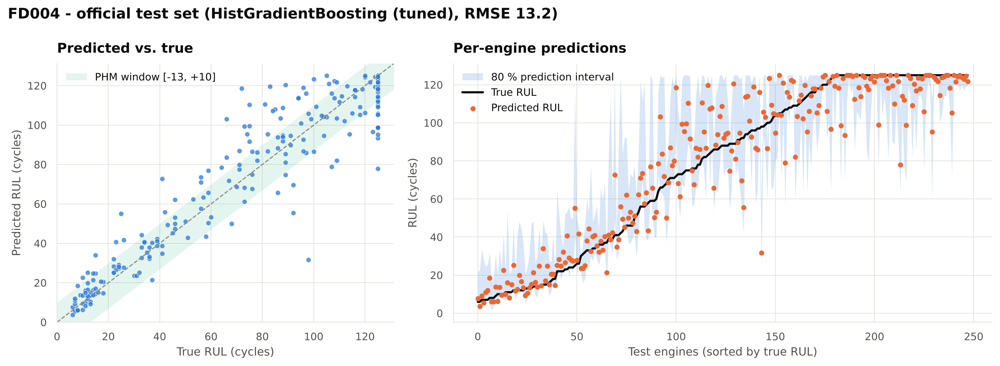
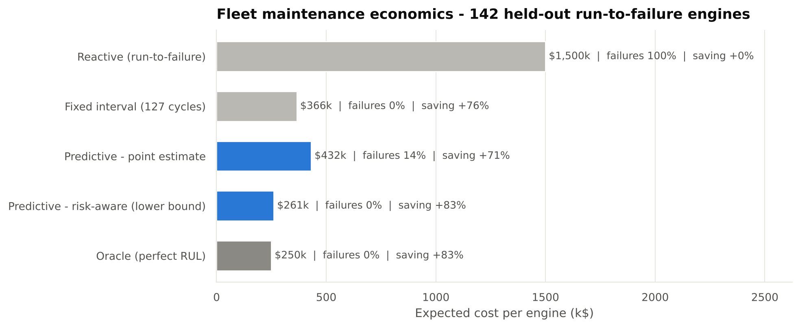
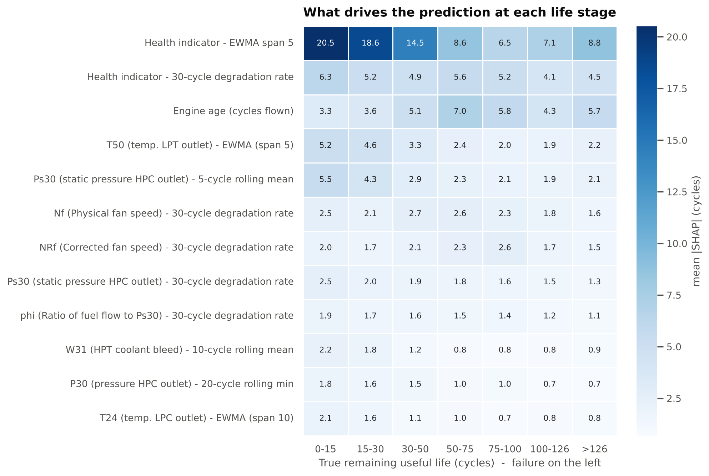
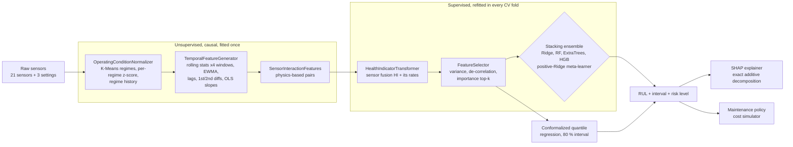

# ✈️ AeroRUL — Remaining Useful Life Prediction for Turbofan Engines

**An end-to-end predictive-maintenance system on NASA C-MAPSS (FD001–FD004): causal feature engineering, stacked tree ensembles, conformal prediction intervals, exact SHAP explanations, a maintenance-cost simulator and a Streamlit monitoring app. Classical ML only (scikit-learn, no deep learning).**

[](https://aerorul.streamlit.app)    

**[▶ Try the live demo](https://aerorul.streamlit.app)** · [Technical report](reports/final_report.md) · [Notebooks](notebooks/) · [Results](#results-at-a-glance)

---

## Why this matters

An unplanned engine removal (an aircraft grounded away from base, secondary damage, a disrupted schedule) costs several times more than a planned shop visit. Fixed-interval maintenance avoids failures but has to be calibrated on the *weakest* engines of the fleet, so it throws away a large share of the useful life of every other engine. **Predicting each engine's Remaining Useful Life (RUL), with a trustworthy uncertainty band, lets maintenance be planned exactly when it is needed.**

AeroRUL answers three questions for every engine in a fleet:

1. **How many cycles are left?** Point estimate of the RUL.
2. **How sure are we?** An 80 % prediction interval with a coverage guarantee (conformal prediction).
3. **Why?** An exact SHAP decomposition of the prediction into physical sensor signals.

## Results at a glance

**Official NASA test sets** (last cycle of every test engine, true RUL clipped at 125). The production model is selected per scenario on validation engines; the test set is never used for a decision.

| Scenario | Production model | RMSE | MAE | R² | NASA score | PHM accuracy¹ | C-index | 80 % PI coverage | PI half-width |
|---|---|---:|---:|---:|---:|---:|---:|---:|---:|
| FD001 · 1 regime, 1 fault | Stacking ensemble | **12.19** | 9.07 | 0.907 | 250 | 71.0 % | 0.879 | 82.0 % | ± 14.3 |
| FD002 · 6 regimes, 1 fault | HistGradientBoosting | **12.40** | 8.80 | 0.917 | 702 | 70.7 % | 0.907 | 82.6 % | ± 13.8 |
| FD003 · 1 regime, 2 faults | HistGradientBoosting (tuned) | **11.29** | 7.30 | 0.917 | 256 | 79.0 % | 0.918 | 74.0 % | ± 12.6 |
| FD004 · 6 regimes, 2 faults | HistGradientBoosting (tuned) | **13.25** | 8.78 | 0.905 | 873 | 72.6 % | 0.909 | 80.2 % | ± 15.4 |

¹ share of predictions within the PHM08 window [-13, +10] cycles. The linear baseline (Ridge on the same features) scores 15.8–18.5 RMSE.



**Business impact.** Maintenance policies simulated on the 142 held-out run-to-failure engines of the four scenarios (10-cycle logistics lead time, illustrative costs from `config.yaml`):

| Strategy | Unplanned failures | Wasted life / engine | Cost / engine | vs. reactive |
|---|---:|---:|---:|---:|
| Reactive (run-to-failure) | 142 / 142 | 0 | $1,500k | — |
| Fixed interval (127 cycles, optimised on training engines) | 0 | 96.9 cycles | $366k | −76 % |
| Predictive, point estimate | 20 / 142 | 4.8 cycles | $432k | −71 % |
| **Predictive, risk-aware (lower 80 % bound)** | **0** | **9.3 cycles** | **$261k** | **−83 %** |
| Oracle (perfect RUL) | 0 | 0 | $250k | −83 % |

The risk-aware policy gets within 4.5 % of the theoretical optimum with zero unplanned failures. Acting on the point estimate alone lets 14 % of engines fail. Even with its alarm threshold re-tuned for safety (34 cycles), it stays about 6 % more expensive than the risk-aware policy and wastes twice as much useful life. **The uncertainty estimate is where the money is.**



**Key technical findings**
* Regime normalisation makes the six-regime FD002 as accurate as the single-regime FD001 (12.4 vs 12.2 RMSE).
* Feature ablation (FD001): **degradation-rate features (rolling slopes) are the most valuable family** (16.4 → 13.3 RMSE); lag features add nothing and get ~0 SHAP attribution.
* The production models learn physically plausible responses: a sigmoid effect of the health indicator, and the HPC-degradation signature (Ps30, T50, fan/core speeds, phi) as the main drivers.
* Validation on truncated held-out engines tracks the official test score (Spearman ρ = 0.81 across 24 model × dataset pairs).




## Architecture



Everything that sees the target (health indicator, feature selection, models) is fitted **inside** engine-grouped cross-validation. The unsupervised stage is deterministic and label-free, so it is computed only once, which makes hyper-parameter search tractable.

## Project structure

```
AeroRUL/
├── README.md
├── requirements.txt            # pinned versions (models are tied to scikit-learn 1.9.1)
├── LICENSE
├── config.yaml                 # every tunable of the system
├── data/
│   ├── raw/                    # NASA C-MAPSS text files (12 files)
│   ├── processed/              # predictions, validation trajectories, SHAP importances
│   └── external/               # demo fleets for the Streamlit app
├── notebooks/
│   ├── 01_exploratory_data_analysis.ipynb
│   ├── 02_feature_engineering.ipynb
│   ├── 03_model_development.ipynb
│   └── 04_model_explainability.ipynb
├── src/
│   ├── data/          load_data.py (loading, download), preprocess.py (targets, engine-level splits, CV splitter)
│   ├── features/      engineering.py (custom transformers), selection.py (FeatureSelector)
│   ├── models/        train.py (factories, tuning, CQR, isotonic), evaluate.py (metrics, cost simulation),
│   │                  predict.py (RULPredictor bundle, stacked SHAP explainer)
│   ├── utils/         metrics.py (NASA score, C-index...), visualization.py, config/logging/seeding
│   └── pipeline.py    end-to-end training CLI
├── models/                     # serialised production bundles (joblib), one per dataset
├── reports/
│   ├── figures/                # publication-quality figures
│   ├── metrics/                # CSV/JSON results of the last pipeline run
│   └── final_report.md         # technical report
└── app/
    └── streamlit_app.py        # fleet health monitoring demo
```

## Quickstart

```bash
# 1. Environment
python3 -m venv .venv && source .venv/bin/activate     # Windows: .venv\Scripts\activate
pip install -r requirements.txt

# 2. Data (skip if data/raw already holds the 12 .txt files)
python -m src.data.load_data --download                # official NASA archive
python -m src.data.load_data --check                   # sanity check of the 4 subsets

# 3. Train, evaluate, explain and save the four models
python -m src.pipeline                                 # full run (about 25 min on 2 CPU cores)
python -m src.pipeline --datasets FD001 --quick        # smoke test (under a minute)

# 4. Monitoring app
streamlit run app/streamlit_app.py

# 5. Notebooks
jupyter lab notebooks/
```

### Getting the NASA C-MAPSS data manually

If the automatic download fails (corporate proxy, URL change):

1. Open the **NASA Prognostics Center of Excellence data repository**: <https://www.nasa.gov/intelligent-systems-division/discovery-and-systems-health/pcoe/pcoe-data-set-repository/>
2. Download data set **#6 "Turbofan Engine Degradation Simulation"** (direct link: `https://phm-datasets.s3.amazonaws.com/NASA/6.+Turbofan+Engine+Degradation+Simulation+Data+Set.zip`).
3. Unzip it (the archive contains a nested `CMAPSSData.zip`) and copy the 12 files `train_FD00X.txt`, `test_FD00X.txt` and `RUL_FD00X.txt` into `data/raw/`.

Citation: A. Saxena and K. Goebel (2008), *"Turbofan Engine Degradation Simulation Data Set"*, NASA Ames Prognostics Data Repository, Moffett Field, CA.

### Using a trained model in code

```python
from src.data.load_data import read_sensor_table
from src.models.predict import load_predictor

model = load_predictor("FD004")                         # models/aerorul_FD004.joblib
fleet = read_sensor_table("data/external/sample_fleet_FD004.csv")
report = model.predict(fleet)                           # one row per engine, latest cycle
# unit | cycle | rul_pred | rul_lower | rul_upper | health_indicator | risk_level
explanation = model.explain(model.compute_features(fleet).tail(1))   # shap.Explanation
```

## Methodology

### Data & target
* Four scenarios: **FD001** (1 regime, 1 fault mode) → **FD004** (6 regimes, 2 fault modes, 249 training engines).
* The target is the **piece-wise linear RUL**, `min(RUL, 125)`. Sensors are flat during early life (notebook 01), so a larger RUL is not observable.
* The 7 sensors without degradation signal (s1, s5, s6, s10, s16, s18, s19) are discarded.

### Leakage-safe validation
* **The engine is the unit of independence**: every split (hold-out, CV, stacking out-of-fold predictions) is done on whole engines (`EngineGroupKFold`). A plain `TimeSeriesSplit` would not make sense here: engines are independent units with no shared global timeline, and the leakage risk is *within* an engine (overlapping windows). Grouping by engine removes it.
* **Validation mimics production**: the 20 % held-out engines are scored at 10 random truncation points each, which reproduces how the official test set was built. This protocol tracks the official test score closely (notebook 03).
* The **official test set is used only for final reporting**, never for a decision.

### Feature engineering (~520 causal features)
| Family | Details |
|---|---|
| Regime normalisation | K-Means on the operating settings → per-regime z-scoring (the regime explains 96.7–100 % of raw sensor variance in FD002), one-hot regime, cumulative share of life flown in each regime |
| Rolling statistics | mean, std, min, max, skew, kurtosis over 5 / 10 / 20 / 30 cycles |
| EWMA | spans 5 / 10 / 20 |
| Lags | 1 / 3 / 5 cycles |
| Differences | 1st and 2nd order on an EWMA-smoothed signal |
| Degradation rates | rolling OLS slope over 10 / 30 cycles, closed-form and vectorised |
| Interactions | 10 physics-motivated pairs (e.g. T30 × T50 hot-section load, Nc × NRc) |
| Health indicator | linear sensor fusion → HI ∈ [0, 1], plus its smoothed levels and slopes |

All features are **causal**: the value at cycle *t* uses only cycles ≤ *t*, which is verified numerically. The supervised stage is **row-wise**, which is enforced by a runtime guard (`_check_row_invariance` in `src/pipeline.py`). This guard exists because of a real bug caught during development: a health-indicator slope computed over the rows *received*, instead of over the engine history, silently raised the test RMSE from about 13 to about 21 cycles while validation still looked fine.

### Models
* Baselines: Ridge, Random Forest, Extra Trees, HistGradientBoosting (default).
* **HistGradientBoosting tuned** with `RandomizedSearchCV` (12 candidates × 3 engine-grouped folds; `Pipeline(memory=...)` caches the supervised transformers per fold).
* **Stacking**: out-of-fold predictions on engine folds, then a **non-negative Ridge** meta-learner. Its weights stay interpretable and the SHAP decomposition stays exact.
* The production model is chosen per dataset on the validation cut points.

### Uncertainty & calibration
* **Conformalized Quantile Regression** (Romano et al., 2019): quantile GBMs (10 % / 90 %) corrected on the validation engines for finite-sample coverage.
* **Isotonic recalibration** of point predictions, adopted only if engine-grouped CV on the calibration set shows an RMSE gain (it never did here, i.e. the ensembles are already well calibrated).

### Evaluation
RMSE, MAE, R², the **official NASA asymmetric score** (late predictions penalised harder), PHM08 accuracy window [-13, +10], late-prediction rate, **Harrell's C-index** (survival view: does the model rank engines by failure order?), alert precision/recall at 30 cycles, interval coverage and width.

### Explainability
`StackedShapExplainer` combines TreeSHAP (forests, GBM) and closed-form linear SHAP (Ridge) with the meta-learner weights: `φ(stack) = Σ wᵢ φ(fᵢ)`, so the attributions add up exactly. Notebook 04 covers global drivers, importance by physical sensor, **importance across life stages**, local waterfalls of critical engines, and high-risk vs. healthy driver comparison.

### Business simulation
Five strategies are simulated on every held-out run-to-failure engine with a 10-cycle logistics lead time: reactive, fixed interval (optimised on training engines), predictive on the point estimate, **predictive on the lower interval bound**, and an oracle. Costs are set in `config.yaml` (illustrative: an unplanned event costs 6× a planned shop visit, and early removal costs the value of the discarded useful life). A sensitivity analysis over the failure-cost ratio is included. The risk-aware policy is the cheapest realistic strategy for every failure-cost ratio from 2× to 20×, and an alarm-threshold sweep shows that it is also the most robust to threshold choice.

## Production design choices

| Concern | Implementation |
|---|---|
| Single artefact | `RULPredictor` bundles the feature pipeline, model, interval model, calibrator and metadata: **raw sensors in, RUL + interval + risk out** |
| Configuration | Everything in `config.yaml` (features, models, search space, costs, thresholds) |
| Reproducibility | Global seed, seeded splits, seeded estimators, deterministic features |
| Logging | Structured logs to stderr and `reports/pipeline.log` |
| Inference safety | Causality check, row-invariance guard, regime clustering fitted on training data only |
| Serialization | `joblib` with compression, a few MB per model |
| Interfaces | CLI (`src.pipeline`, `src.data.load_data`), Python API, Streamlit app |

## Limitations & next steps
* C-MAPSS is **simulated**: real fleets add sensor drift, maintenance actions (partial recoveries), censored histories and missing data.
* The conformal guarantee is **marginal**: test coverage is 80–83 % on three scenarios but 74 % on FD003 (calibrated on only 20 validation engines), and per-life-stage coverage ranges from 63 % to 95 % (`reports/figures/*_interval_coverage.png`). *Mondrian* (per-stage) conformal prediction and a larger calibration set would tighten this.
* Next: survival models (e.g. scikit-survival gradient-boosted Cox) for censored fleet data, drift monitoring, a containerised REST API around `RULPredictor`, and a fleet-level optimiser of shop-visit capacity.

## References
* A. Saxena, K. Goebel, D. Simon, N. Eklund (2008). *Damage propagation modeling for aircraft engine run-to-failure simulation*. PHM 2008.
* F. O. Heimes (2008). *Recurrent neural networks for remaining useful life estimation*. PHM 2008 (piece-wise linear target).
* T. Wang, J. Yu, D. Siegel, J. Lee (2008). *A similarity-based prognostics approach for RUL estimation of engineered systems*. PHM 2008 (health indicator).
* Y. Romano, E. Patterson, E. Candès (2019). *Conformalized Quantile Regression*. NeurIPS.
* S. Lundberg, S.-I. Lee (2017). *A Unified Approach to Interpreting Model Predictions*. NeurIPS.

## License

Released under the [MIT License](LICENSE). The C-MAPSS data belongs to NASA and is not redistributed in this repository.

---
*Author: **Elio Torga** · [GitHub](https://github.com/elio-torga) · [LinkedIn](https://www.linkedin.com/in/elio-torga-3b1083378)*
