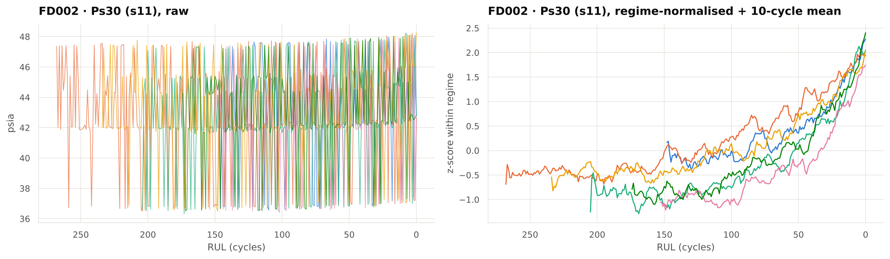
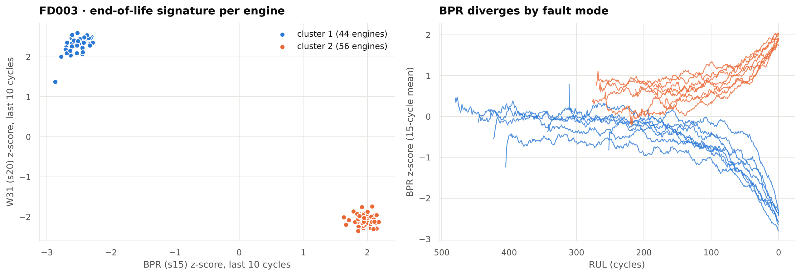
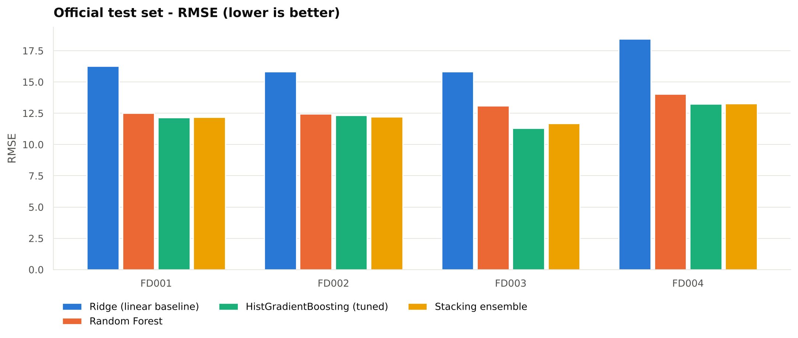
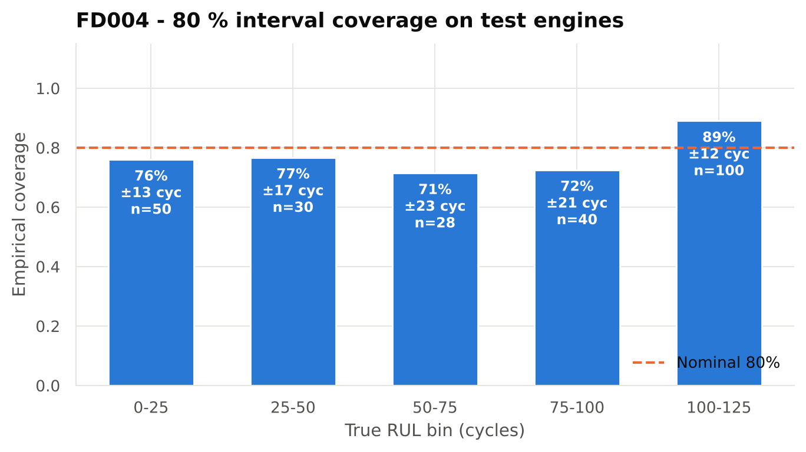
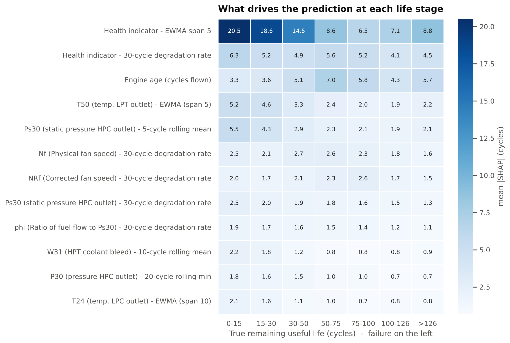
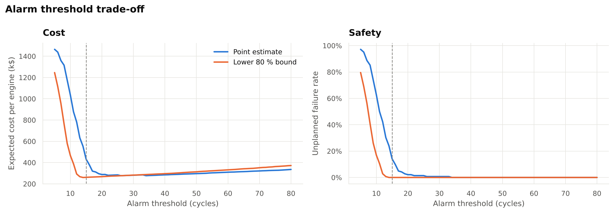

# AeroRUL — Technical Report

**Remaining Useful Life prediction for turbofan engines on NASA C-MAPSS (FD001–FD004)**

*All numbers in this report come from the pipeline run stored in `reports/metrics/` (seed 42) and can be reproduced with `python -m src.pipeline`.*

---

## Executive summary

* AeroRUL predicts the remaining useful life of turbofan engines from raw sensor streams with an **RMSE of 11.3–13.3 cycles** on the four official NASA test sets, using classical machine learning only (scikit-learn tree ensembles on ~520 engineered, strictly causal features).
* Every prediction comes with an **80 % conformal prediction interval** (empirical test coverage 74–83 %) and an **exact SHAP explanation** expressed in physical sensor terms.
* On 142 held-out run-to-failure engines, a maintenance policy that triggers on the **lower bound** of the interval avoids every unplanned failure and costs **$261k per engine**, against $366k for the best fixed-interval policy and $1.5M for run-to-failure, which is **within 4.5 % of a perfect-information oracle**. Acting on the point estimate alone lets 14 % of the engines fail.
* The system ships as a single serialised bundle per scenario (raw sensors in, RUL + interval + risk + explanation out), a CLI training pipeline driven by `config.yaml`, and a Streamlit fleet-monitoring application.

---

## 1. Problem and business context

Engine removals are among the largest maintenance cost items of an airline. An **unplanned** removal adds aircraft-on-ground time, secondary damage, spare-engine leasing and network disruption on top of the shop visit. A **planned** removal can be scheduled at a convenient base, with parts and slots booked. Fixed-interval maintenance avoids failures, but it has to be set by the shortest-lived engines and throws away useful life on all the others (lifetimes vary by a factor of 2–3 within a single C-MAPSS fleet).

The goal is therefore not only accurate RUL estimates, but estimates that a maintenance planner can **act on safely**: calibrated uncertainty, explainable drivers, and a clear decision rule whose economic value is quantified.

The economic parameters used here are **illustrative** (`config.yaml > business`): an unplanned failure costs $1.5M (6× a planned $250k shop visit), each cycle of useful life discarded by early removal is worth $1,200, and a removal decision takes 10 cycles to execute.

## 2. Data

| Scenario | Regimes | Fault modes | Train engines | Test engines | Median life (train) |
|---|---:|---:|---:|---:|---:|
| FD001 | 1 | 1 (HPC) | 100 | 100 | 199 |
| FD002 | 6 | 1 (HPC) | 260 | 259 | 199 |
| FD003 | 1 | 2 (HPC + fan) | 100 | 100 | 220 |
| FD004 | 6 | 2 (HPC + fan) | 249 | 248 | 234 |

Main EDA findings (`notebooks/01_exploratory_data_analysis.ipynb`):

1. **Operating regimes mask degradation.** In FD002 the operating regime explains 96.7–100 % of the raw variance of every informative sensor. K-Means on the three operating settings recovers six well-separated regimes, and per-regime z-scoring makes the degradation trend visible.
2. **Seven sensors are uninformative** (s1, s5, s6, s10, s16, s18, s19): constant, or varying only with the regime. The same 14 sensors are kept for all scenarios.
3. **Degradation is flat, then accelerating.** No measurable drift appears until roughly 100–125 cycles before failure, which justifies the piece-wise linear target `min(RUL, 125)`.
4. **Two fault modes leave opposite fingerprints.** In FD003, the engines split into two clean clusters near failure (44 vs 56 engines, strongly preferred by BIC): bypass ratio up and coolant bleed down for one mode, the reverse for the other. These sensors correlate strongly with RUL in FD001/FD002 and show near-zero *linear* correlation in FD003/FD004, even though they remain highly informative.




## 3. Methodology

### 3.1 Validation protocol

| Set | Content | Use |
|---|---|---|
| Training engines (80 %) | full trajectories, every 2nd cycle | fitting; engine-grouped 3-fold CV for tuning; 5-fold out-of-fold predictions for stacking |
| Validation engines (20 %) | 10 random truncation points per engine | model selection, conformal calibration, isotonic decision |
| Validation engines | full trajectories | maintenance-policy simulation |
| Official test set | last cycle of each engine | final reporting only |

Engines never straddle a split (`EngineGroupKFold`). A plain `TimeSeriesSplit` was deliberately not used: the C-MAPSS engines are independent units with no common timeline, and the leakage risk sits *within* an engine (overlapping windows). Truncation-point validation reproduces how the test set was built. It tracks the test score with a Spearman ρ of 0.81 across the 24 model × scenario pairs.

### 3.2 Features

The unsupervised stage (fitted once, on training engines only) produces 510 features for single-regime scenarios and 522 for multi-regime ones:

* `OperatingConditionNormalizer`: K-Means regimes, per-regime z-scores, one-hot regime, cumulative share of life flown in each regime;
* `TemporalFeatureGenerator`: rolling mean/std/min/max/skew/kurtosis (windows 5/10/20/30), EWMA (5/10/20), lags (1/3/5), 1st/2nd differences of a smoothed signal, rolling OLS slopes (10/30) computed in closed form;
* `SensorInteractionFeatures`: products and differences of 10 physics-motivated sensor pairs.

The supervised stage (refitted inside every CV fold) contains:

* `HealthIndicatorTransformer`: a linear sensor-fusion health indicator in [0, 1] (Wang et al., 2008), with its smoothed levels and slopes. Because the HI is linear in the smoothed sensors, its slope is exactly `w · s_slope`, so the stage stays **row-wise**;
* `FeatureSelector`: variance filter, then greedy de-correlation (|r| < 0.98), then the Extra-Trees importance top-120.

Every feature is causal (verified: features of a trajectory truncated at cycle *t* equal those of the full trajectory at *t*, with zero difference).

### 3.3 Models

Ridge (baseline), Random Forest, Extra Trees, HistGradientBoosting (default and tuned), and a **stacking ensemble** (the four base learners combined by a non-negative Ridge meta-learner trained on engine-grouped out-of-fold predictions). HistGradientBoosting is tuned with `RandomizedSearchCV` (12 candidates × 3 engine folds; a `Pipeline(memory=...)` cache avoids refitting the supervised transformers for every candidate). The same candidate won on FD001–FD003 (learning rate 0.043, 330 iterations, 15 leaves, min. 80 samples per leaf, feature subsampling 0.5). FD004 preferred a slower, larger model (0.021, 755 iterations, 31 leaves).

### 3.4 Uncertainty and calibration

* **Conformalized Quantile Regression** (Romano et al., 2019): quantile GBMs at 10 % / 90 %, widened by the conformal correction computed on validation cut points. The raw quantile coverage on validation was 64–74 % and the conformal corrections were +0.6 to +2.4 cycles.
* **Isotonic recalibration** of point predictions is adopted only if engine-grouped CV on the calibration set shows a gain of at least 1 %. It was **not adopted on any scenario**: CV RMSE got worse in every case, i.e. the ensembles were already well calibrated.

## 4. Results

### 4.1 Official test sets — RMSE (cycles)

| Model | FD001 | FD002 | FD003 | FD004 |
|---|---:|---:|---:|---:|
| Ridge (linear baseline) | 16.26 | 15.82 | 15.82 | 18.45 |
| Random Forest | 12.51 | 12.46 | 13.10 | 14.03 |
| Extra Trees | 12.64 | 12.28 | 13.47 | 14.37 |
| HistGradientBoosting (default) | 12.23 | 12.40 | 11.12 | 13.45 |
| HistGradientBoosting (tuned) | 12.14 | 12.32 | 11.29 | 13.25 |
| Stacking ensemble | 12.19 | 12.22 | 11.70 | 13.26 |
| **Production (validation-selected)** | **12.19** | **12.40** | **11.29** | **13.25** |

### 4.2 Production models — full metric set

| Metric | FD001 | FD002 | FD003 | FD004 |
|---|---:|---:|---:|---:|
| Selected model | Stacking | HGB (default) | HGB (tuned) | HGB (tuned) |
| RMSE | 12.19 | 12.40 | 11.29 | 13.25 |
| MAE | 9.07 | 8.80 | 7.30 | 8.78 |
| R² | 0.907 | 0.917 | 0.917 | 0.905 |
| NASA score (sum) | 250 | 702 | 256 | 873 |
| NASA score per engine | 2.50 | 2.71 | 2.56 | 3.52 |
| PHM accuracy [-13, +10] | 71.0 % | 70.7 % | 79.0 % | 72.6 % |
| Late predictions (> +10) | 20.0 % | 18.9 % | 15.0 % | 17.7 % |
| C-index | 0.879 | 0.907 | 0.918 | 0.909 |
| Alert precision / recall (≤ 30 cycles) | 1.00 / 0.84 | 0.98 / 0.98 | 0.95 / 0.95 | 0.94 / 0.91 |
| 80 % interval coverage | 82.0 % | 82.6 % | 74.0 % | 80.2 % |
| Mean interval width | 28.6 | 27.6 | 25.2 | 30.7 |



**Interpretation**

* Tree ensembles beat the linear baseline by 3.6–5.2 RMSE cycles. The gap is largest where two fault modes coexist.
* Tuned HGB, default HGB and stacking are within about 0.5 cycles of each other everywhere, which is within the noise of a 100–250-engine test set. Validation selection chose stacking for FD001 and HGB elsewhere. The stacking meta-learner on FD001 puts 0.88 of its weight on HGB, 0.12 on Extra Trees and 0 on Ridge.
* Thanks to regime normalisation, the six-regime FD002 is as accurate as FD001. FD004, which combines six regimes and two fault modes, is the hardest scenario.
* A C-index of about 0.9 means the model ranks failure order correctly for about 9 out of 10 engine pairs, the property fleet planning relies on.

### 4.3 Feature ablation (FD001, tuned HGB, test RMSE)

| Feature set | Features | RMSE | NASA |
|---|---:|---:|---:|
| Raw normalised sensors + age | 15 | 17.71 | 648 |
| + rolling statistics | 351 | 16.10 | 436 |
| + EWMA, lags, differences | 463 | 16.41 | 461 |
| + slopes & interactions | 511 | 13.32 | 310 |
| + health indicator + selection (full) | 120 | **12.14** | **242** |

Degradation **rates** (rolling slopes) are the most valuable family. EWMA/lags/differences are redundant once rolling statistics are present. The final model is both more accurate and 4× smaller in input than the unselected feature set.

## 5. Uncertainty



Interval half-widths adapt to the life stage: about ± 5 cycles near failure and up to ± 20 mid-life, where degradation onset is uncertain. Test coverage meets the nominal 80 % on three scenarios. It is 74 % on FD003, where the conformal correction was estimated on only 20 validation engines, and a deviation of a few points on a 100-engine test set is within sampling noise. Per-stage coverage ranges from 63 % to 95 % because the guarantee is **marginal** (see Limitations).

## 6. Explainability

The stacking ensemble is explained **exactly**: SHAP values are additive over a linear combination of models, so `φ(stack) = Σ wᵢ φ(fᵢ)` with TreeSHAP for the tree learners and closed-form linear SHAP for Ridge. Local accuracy holds to 1e-13 cycles (`notebooks/04_model_explainability.ipynb`).

* **Global drivers (FD001):** the smoothed health indicator (contribution from about −22 to +11 cycles), engine age, the HI's 30-cycle degradation rate, then T50 and Ps30 levels and the 30-cycle slopes of the fan speed, Ps30 and phi. Aggregated by physical sensor, Ps30 and T50 lead: the HPC efficiency-loss signature.
* **Learned response:** the effect of the health indicator is sigmoid. It saturates when the engine is healthy (HI > 0.8), drops steeply between 0.7 and 0.5, and saturates again below 0.4.
* **Over the life of an engine:** the health indicator's contribution triples toward failure, age matters most mid-life, and sensor *levels* become decisive only in the last ~30 cycles, while slopes contribute steadily.
* **High-risk predictions** come from a consistent multi-sensor pattern, not a single anomalous channel. The same features push healthy engines in the opposite direction.
* **Across scenarios:** HI, rolling statistics and slopes account for 77–81 % of attribution. FD002 relies most on the HI (53 %, since fusion averages out residual regime noise). FD003 relies least on it (22 %) and most on sensor slopes (30 %), consistent with its two opposite fault signatures. Lags receive about 0 % everywhere.



## 7. Business impact

Policies simulated on all held-out validation engines (10-cycle lead time; failure during the lead time counts as unplanned):

| Strategy | FD001 | FD002 | FD003 | FD004 | Fleet (142 engines) | Failures (fleet) |
|---|---:|---:|---:|---:|---:|---:|
| Reactive | $1,500k | $1,500k | $1,500k | $1,500k | $1,500k | 142 |
| Fixed interval (trained optimum) | $352k | $341k | $371k | $388k | $366k | 0 |
| Predictive — point estimate | $505k | $352k | $442k | $482k | $432k | 20 |
| **Predictive — lower 80 % bound** | **$261k** | **$260k** | **$261k** | **$262k** | **$261k** | **0** |
| Oracle | $250k | $250k | $250k | $250k | $250k | 0 |

* The risk-aware policy saves **83 % vs. run-to-failure** and **29 % vs. the best fixed interval** (about $105k per engine, i.e. ~$15M on the 142 simulated engines).
* **Robustness to the cost assumption:** for failure costs from 2× to 20× a shop visit, the risk-aware policy stays the cheapest realistic strategy ($261k per engine, unchanged because it causes no failures). The point-estimate policy beats fixed intervals only at 2×.
* **Robustness to the threshold:** the point estimate needs a 34-cycle alarm threshold to reach zero failures ($277k, ~15 wasted cycles per engine). The lower bound reaches zero failures at 14 cycles ($260k, ~8 wasted cycles). The interval adapts the safety margin engine by engine, which a fixed threshold cannot do.



## 8. Engineering

* **Single artefact.** `RULPredictor` (joblib, 1–9 MB) contains the fitted feature pipeline, model, conformal interval model, calibrator and metadata.
* **Safety nets.** A numerical causality check, plus a runtime **row-invariance guard**: predictions on the latest rows must equal predictions on full trajectories subsetted to those rows, otherwise training aborts.
* **Reproducibility.** One seed drives the splits, estimators, searches and sampling. All parameters live in `config.yaml`, and logs go to stderr and `reports/pipeline.log`.
* **Performance.** Feature generation is fully vectorised (about 2 s for 54k rows × 520 features). The full four-scenario training run takes about 25 minutes on 2 CPU cores.
* **Quality.** PEP8 (flake8-clean, 100-column lines), docstrings on every public component, and a Streamlit app tested headless with `streamlit.testing.AppTest`.

### Lesson learned

The first version of the health-indicator transformer computed the HI slope with a group-by over **the rows it received**. Training and validation (many rows per engine) looked fine, but at inference, where only the last row of each engine is passed, the slope collapsed to zero and test RMSE degraded from about 13 to about 21 cycles. The fix (deriving the HI dynamics analytically from causal sensor features) and the permanent row-invariance guard came out of this. Any model stage that aggregates across rows must be treated as a potential train/serve skew.

## 9. Limitations and future work

* **Simulated data.** Real fleets add sensor drift and faults, partial recoveries after maintenance, censored histories, and varying data quality. Survival models such as gradient-boosted Cox (scikit-survival) would make use of censored engines.
* **Marginal coverage.** Mondrian (life-stage-conditional) conformal prediction and a larger calibration set would equalise coverage across life stages and scenarios.
* **Illustrative economics.** The cost model ignores shop-visit capacity, spare-engine availability and part-life limits. A fleet-level scheduling optimiser is the natural next layer.
* **Operations.** Next steps would be drift monitoring on the input features, scheduled re-training, and a containerised REST service around `RULPredictor`.

## 10. Reproduction

```bash
pip install -r requirements.txt
python -m src.data.load_data --download   # or copy the 12 NASA files into data/raw/
python -m src.pipeline                    # trains, evaluates, explains, saves models & figures
streamlit run app/streamlit_app.py
```

## References

1. A. Saxena, K. Goebel, D. Simon, N. Eklund. *Damage propagation modeling for aircraft engine run-to-failure simulation.* PHM 2008.
2. A. Saxena, K. Goebel. *Turbofan Engine Degradation Simulation Data Set.* NASA Ames Prognostics Data Repository, 2008.
3. F. O. Heimes. *Recurrent neural networks for remaining useful life estimation.* PHM 2008.
4. T. Wang, J. Yu, D. Siegel, J. Lee. *A similarity-based prognostics approach for remaining useful life estimation of engineered systems.* PHM 2008.
5. Y. Romano, E. Patterson, E. Candès. *Conformalized Quantile Regression.* NeurIPS 2019.
6. S. Lundberg, S.-I. Lee. *A Unified Approach to Interpreting Model Predictions.* NeurIPS 2017.
